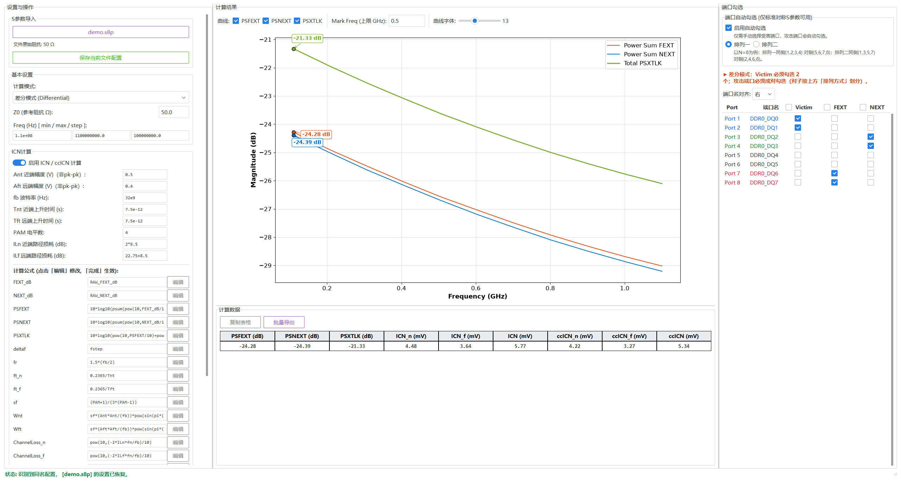
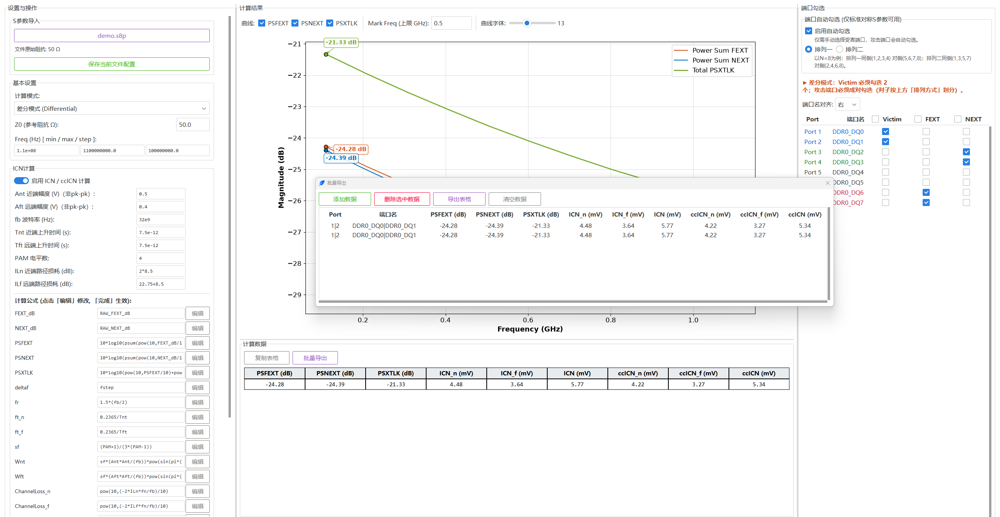

# S参数串扰计算工具

一款面向信号完整性（SI）仿真的桌面工具：导入 Touchstone（.sNp）S 参数文件，快速计算并绘制串扰功率和指标 **PSFEXT（远端串扰）/ PSNEXT（近端串扰）/ PSXTLK（总串扰）**，支持差分（Differential）与单端（Single-Ended）两种分析模式，并在此基础上计算集成串扰噪声 **ICN / ccICN**。

典型场景：DDR/LPDDR 等并行总线的布线串扰评估——从仿真工具（HFSS / SIwave / Cadence 等）导出多端口 S 参数，勾选受害线（Victim）与攻击线（Aggressor），即可得到各频段的总串扰包络曲线与 ICN/ccICN 数值，用于对比不同布线方案的串扰裕量。




## 功能特性

- 单窗口三栏布局（设置与操作 / 计算结果 / 端口勾选），启动即最大化，栏宽可拖动调整
- 全局字体（左栏「界面设置」下拉框）与曲线字体（曲线操作栏滑块）即时可调；端口勾选行按角色变色（Victim 蓝 / FEXT 红 / NEXT 绿）
- 差分 / 单端两种模式实时切换；差分模式自动做混合模（Mixed-Mode）转换取 Sdd 耦合项
- 端口勾选表：Victim / FEXT / NEXT 三类角色真实勾选框，表头内嵌按列全选/全反选勾选框，支持自动勾选推演
- 功率和曲线即时重算重绘；Mark Freq 自动标注各曲线峰值
- 「计算数据」表格汇总 Mark 峰值与 ICN/ccICN 结果，一键复制到 Excel，或经「批量导出」窗口逐组缓存后导出 CSV
- 20 条计算公式全部可在界面查看/编辑（白名单安全求值），ICN 积分步长 deltaf 公式化
- 配置持久化：按 S 参数文件同名 .json 保存/自动恢复全部设置
- 可打包为 Windows exe（onedir，免 Python 环境运行）

## 安装与运行

环境要求：Python 3.10+（开发环境为 3.14），Windows / macOS / Linux 均可（打包脚本面向 Windows）。

```bash
# 1. 建议使用虚拟环境
python -m venv .venv
# Windows:
.venv\Scripts\activate
# macOS / Linux:
source .venv/bin/activate

# 2. 安装依赖
pip install -r requirements.txt

# 3. 运行
python main.py                # 打开空界面
python main.py 路径/文件.s8p   # 启动时自动导入指定文件
```

软件自带示例文件 `sample_data/demo.s8p`（8 端口 DDR 数据线示例，仅供上手演示）。

## 打包为 exe（Windows）

```bash
pip install pyinstaller
pyinstaller main.spec --noconfirm
```

产出目录版 `dist/S参数串扰计算_dir/`（onedir，整个目录一起分发；启动 1–2 秒）。弃用单文件版（onefile 每次启动需向临时目录解包并被杀软扫描，实测 8–9 秒且偶发尖峰）。

## 代码结构

| 文件 / 目录 | 说明 |
| --- | --- |
| `main.py` | 程序入口：创建 ttkbootstrap 主窗口，支持命令行传入 .sNp 文件路径自动导入 |
| `app.py` | GUI 主程序（ttkbootstrap）：单窗口三栏（设置与操作 / 计算结果 / 端口勾选）、曲线绘制与 Mark 峰值标注、「计算数据」表格、「批量导出」窗口（CSV 导出）、自动计算调度（防抖重算、重采样缓存）、配置文件读写 |
| `sparam_core.py` | 计算核心（无界面依赖）：Touchstone .sNp 解析、阻抗归一化、PCHIP 重采样、差分对子划分与混合模转换、功率和（PSFEXT/PSNEXT/PSXTLK）计算、ICN/ccICN 公式驱动计算与安全表达式求值器 |
| `main.spec` | PyInstaller 打包配置（onedir；显式收集 ttkbootstrap 主题资源） |
| `backup.py` | 本地开发辅助：更新代码前把源文件按时间戳备份到 `backup/` 目录 |
| `sample_data/demo.s8p` | 8 端口示例 S 参数文件（合成数据，仅供演示） |
| `docs/images/` | README 界面截图（主界面、批量导出窗口），与当前版本 UI 一致 |
| `requirements.txt` | 运行依赖清单（含可选的打包/测试依赖说明） |
| `tests/` | 本地测试目录（单元测试 + GUI 冒烟测试 + 性能测量脚本），未纳入版本库 |

运行时数据流向：`main.py` → `app.py`（界面与调度）→ `sparam_core.py`（纯计算）；界面可编辑的公式经 `sparam_core.evaluate_expr` 白名单求值，禁止任意代码执行。

## 界面说明

软件启动后即为最大化窗口（非全屏），从左到右分为三栏：**设置与操作**、**计算结果**、**端口勾选**；三栏宽度均可拖动分割条调整，左右两栏默认宽度随内容自适应；底部为全宽状态栏。

**左栏 — 设置与操作**（内容较多，可滚动）

| 控件 | 功能 |
| --- | --- |
| S参数导入 | 选择导入 .sNp 文件，导入后显示文件原始阻抗 Z0；「保存当前文件配置」按钮也在此分组内：将变量、公式与端口勾选等配置存为同名 .json，重新导入该文件时自动恢复；未导入文件时保存为程序目录下的 spara_ui_default.json（缺省默认配置），启动时自动加载 |
| 基本设置：计算模式 | 差分模式（Victim 勾选 2 个端口，攻击端口成对勾选）或单端模式（Victim 勾选 1 个端口） |
| 基本设置：Z0 | 参考阻抗（Ω），S 参数自动重归一化到该阻抗，默认 50 |
| 基本设置：Freq [min/max/step] | 重采样频率范围与步长，单位 Hz，科学计数法显示与输入（如 `1e+08`），支持表达式；按 min/max/step 把 S 参数重组到等间隔网格，导入文件后自动填入文件频率范围与原始间隔，修改后自动重建重采样缓存并重算 |
| ICN计算：启用开关 | 「启用 ICN / ccICN 计算」开关；关闭时不计算 ICN/ccICN，「计算数据」表格也不显示对应数据列 |
| ICN计算变量 | Ant/Aft 攻击幅度（V，中轴到 peak，非pk-pk值）、fb 波特率（Hz）、Tnt/Tft 上升时间（s）、PAM 电平数、ILn/ILf 攻击路径损耗（dB）；均支持高精度小数、科学计数法（如 `32e9`）与表达式（如 `2*8.5`、`22.75+8.5`），不做四舍五入 |
| 计算公式 | 20 条公式（FEXT_dB / NEXT_dB / PSFEXT / PSNEXT / PSXTLK / deltaf / fr / ft_n / ft_f / sf / Wnt / Wft / ChannelLoss_n / ChannelLoss_f / ICN_n / ICN_f / ICN / ccICN_n / ccICN_f / ccICN）只读展示；点击「编辑」修改、点击「完成」校验生效，计算沿用当前公式；deltaf 为 ICN 积分步长公式（Hz），默认等于基本参数 fstep |
| 界面设置：全局字体大小 | 下拉框 9–14 选择，即时全局生效；默认字号以 2K 27 英寸屏为基准（11，小屏 10） |

**中栏 — 计算结果**

- 曲线操作栏在曲线图上方：曲线开关（PSFEXT / PSNEXT / PSXTLK）、Mark Freq（GHz，在指定频率上限内自动标注各可见曲线的峰值点，便于读数）与曲线字体滑块（8–22，即时重绘）；
- 自动计算并绘制 PSFEXT / PSNEXT / PSXTLK 三条功率和曲线（修改参数即时重算）；差分与单端模式可实时切换对比；曲线图始终保持 16:10 比例，在可用空间内居中自适应，与下方「计算数据」表格上下分割、分割线可上下拖动（计算数据区默认高度约占窗口 1/3）；
- 曲线图下方「计算数据」区域以 1 行表格展示数据，表格带明显框线，每列表头标注单位：左侧为勾选曲线的 Mark 峰值列（PSFEXT / PSNEXT / PSXTLK，单位 dB，未勾选的曲线不显示该列，未设置 Mark Freq 时显示 `--`）；右侧为 ICN_n / ICN_f / ICN / ccICN_n / ccICN_f / ccICN 共 6 列（单位随数值量级在 V / mV / µV / nV / pV 间自适应，数值保留 2 位小数；左栏 ICN 开关关闭时不显示）；单元格文本可自由框选复制，表格上方左侧的「复制表格」按钮把整表（表头 + 数值行，制表符分隔）复制到剪贴板，可直接粘贴进 Excel；
- 「批量导出」按钮打开批量导出窗口：点击「添加数据」把当前计算数据缓存进列表（单端端口一行；差分端口也是一行，两个端口在 Port / 端口名列内以 `|` 合并），列表列结构与数值单位实时跟随主界面「计算数据」表格，窗口宽度随列表总宽自适应；选中行（支持 Ctrl 多选 / Shift 批量选）后点「删除选中数据」可移除误添加的行，可逐组端口累计多行后点击「导出表格」一次性导出为 CSV（弹出保存对话框，默认路径为 S 参数所在目录，utf-8-sig 编码可直接用 Excel 打开），「清空数据」则清空缓存重新添加；该窗口随主窗口关闭而关闭，自身关闭不影响主窗口（缓存保留）。



**右栏 — 端口勾选**

- 「端口自动勾选」分组：仅需手动指定受害端口，按封装引脚排列（排列一/排列二）自动推演攻击端口；差分模式下手动勾选的攻击端口也按该排列方式划分对子；
- 导入文件后列出全部端口，每行从左到右为 Port 序号、端口名（默认右对齐，可切换左/居中；栏宽随端口名文字长度实时自适应）、Victim / FEXT / NEXT 真实勾选框；勾选行按角色变色（Victim 蓝 / FEXT 红 / NEXT 绿，只改颜色不改字体）；表头冻结在滚动区外不随数据行滚动，三列角色表头内嵌全选/全反选勾选框；竖向滚动条固定显示；差分模式下攻击端口须成对勾选。

## 计算口径

- 功率和：各攻击路径线性功率相加后再取 dB，即 PSXTLK = 10·log10(Σ 10^(dBᵢ/10))（假设各攻击源非相干）；
- 差分模式：对受害端口对做混合模（Mixed-Mode）转换后取 Sdd 耦合项；差分对子按「排列方式」划分（排列一：(1,2)(3,4)…，排列二：(1,3)(2,4)(5,7)(6,8)…），对子不完整时拒绝计算并提示；计算完成后状态栏回显实际参与计算的端口对子，便于核对；
- 重采样预处理：按基本参数（Z0 / Freq min/max/step）对 S 参数先做全端口阻抗归一化，再对每个 Sᵢⱼ 的实部/虚部分别做 PCHIP 插值重组到等间隔网格（量程外平坦延拓；不在 dB/功率域插值，避免对数域过冲）；结果作为重采样缓存供快速重算，基本参数任一修改即整体重建，端口勾选/公式/绘图开关变化时直接复用；除该缓存与首次加载的原始数据外不保留任何计算缓存，全程不修改原始 S 参数数据；
- 结果在重采样网格覆盖的频率范围内有效；网格超出文件频率范围的部分为边界延拓值，仅供参考。

## ICN / ccICN 计算

公式驱动、可在界面修改。默认公式：

```
FEXT_dB = RAW_FEXT_dB
NEXT_dB = RAW_NEXT_dB
PSFEXT = 10*log10(psum(pow(10,FEXT_dB/10)))
PSNEXT = 10*log10(psum(pow(10,NEXT_dB/10)))
PSXTLK = 10*log10(pow(10,PSFEXT/10)+pow(10,PSNEXT/10))
deltaf = fstep
fr  = 1.5*(fb/2)
ft_n = 0.2365/Tnt
ft_f = 0.2365/Tft
sf  = (PAM+1)/(3*(PAM-1))
Wnt = sf*(Ant*Ant/(fb))*sinc²(fn/fb) / (1+(fn/ft_n)⁴) / (1+(fn/fr)⁸)
Wft = sf*(Aft*Aft/(fb))*sinc²(fn/fb) / (1+(fn/ft_f)⁴) / (1+(fn/fr)⁸)
ChannelLoss_n = 10^(−2·ILn·fn/fb/10)
ChannelLoss_f = 10^(−2·ILf·fn/fb/10)
ICN_n = √(2·deltaf·Σ Wnt·10^(PSNEXT/10))
ICN_f = √(2·deltaf·Σ Wft·10^(PSFEXT/10))
ICN   = √(ICN_n² + ICN_f²)
ccICN_n = √(2·deltaf·Σ Wnt·10^(PSNEXT/10)·ChannelLoss_n)
ccICN_f = √(2·deltaf·Σ Wft·10^(PSFEXT/10)·ChannelLoss_f)
ccICN   = √(ccICN_n² + ccICN_f²)
```

其中 RAW_FEXT_dB / RAW_NEXT_dB 为从 S 参数直接提取的各攻击路径耦合二维 dB 矩阵（行=攻击路径，列=频点；单端取 20·log10|S(v,k)|，差分取 20·log10|Sdd21|），FEXT_dB / NEXT_dB 默认恒等引用、可编辑修饰（结果形状须与 RAW 矩阵一致）；psum 按路径维逐频点求和；sinc(x) = sin(πx)/(πx)；fn 为按 Freq min/max/step 重采样后的网格频点（Hz）；deltaf 为 ICN 积分步长公式（Hz），默认等于基本参数 fstep，可改为任意表达式；结果单位 V（界面显示换算为 mV）。公式支持的运算：`+ - * / ** pow()`、括号、函数 `sin/cos/tan/asin/acos/atan/sqrt/exp/log/log10/abs/pow/sum/psum/min/max`、常量 `pi/e`。

## 许可证

见 [LICENSE](LICENSE)。
